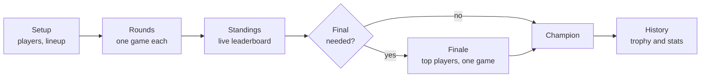
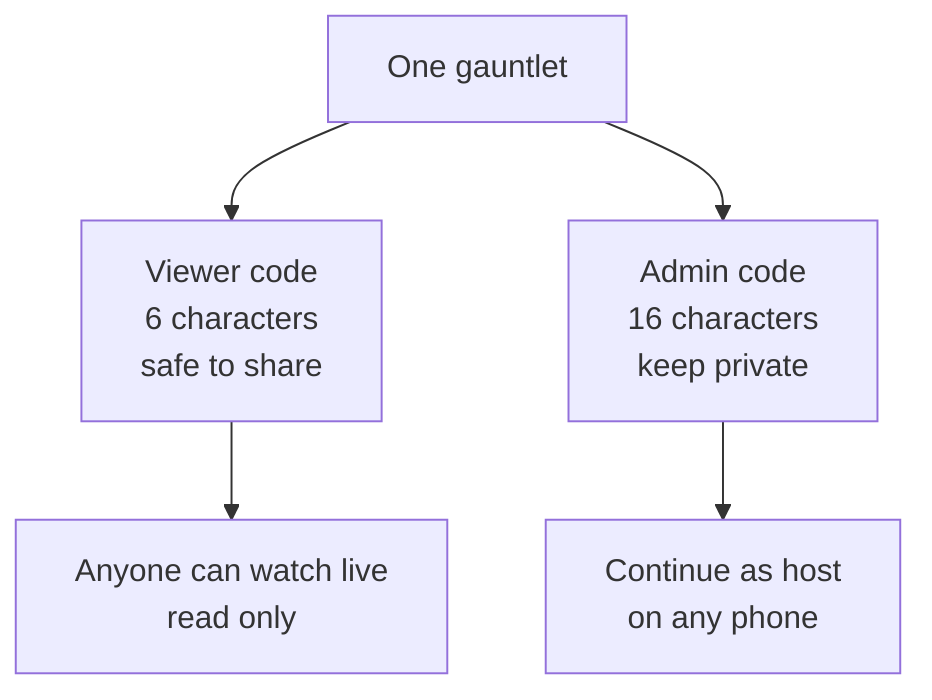
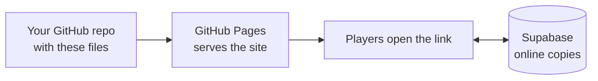

  

<h1 align="center">Game Night Gauntlet</h1>

<b>A family board game championship, tracked from the first round to the trophy.</b>

  
  
  
  

  <a href="#what-it-is">What it is</a> ·
  <a href="#get-started">Get started</a> ·
  <a href="#how-a-gauntlet-works">How it works</a> ·
  <a href="#scoring">Scoring</a> ·
  <a href="#sharing-and-codes">Sharing</a> ·
  <a href="#your-data">Your data</a> ·
  <a href="#why-it-is-built-this-way">Design choices</a> ·
  <a href="#host-your-own-copy">Host your own</a>

---

## What it is

Game Night Gauntlet runs a tournament across **many different board and card games**, played over one or more game nights. Every round is a different game. Each game is worth more or less depending on how big it is, and the points add up to crown an **Ultimate Board Gamer** in a scored final.

It was made for one family that owns single copies of most of its games, so people wait their turn and play is spread over several nights. It works just as well for a group of friends.

> [!NOTE]
> It is a phone-first web app. There is nothing to install and nobody has to make an account. Open the link, start a gauntlet, and play.

### Highlights

| | |
|---|---|
| **Fair across different games** | Every game is worth x1, x2 or x3, so a quick card game never counts as much as a long strategy game. |
| **A final that always matters** | Qualifying points stay close enough that nobody can clinch before the last game. |
| **Picks the games for you** | Say about how many hours you have and tap Auto-pick. The app chooses games from a catalog of 625 family games, fitted to your player count. Or build the lineup yourself, with as many rounds of each game as you like. |
| **Watch live** | Family can follow along from their own phones with a short code. They can only watch. |
| **Saved automatically** | Everything lives on your phone, with an online copy so a lost phone does not lose the gauntlet. |
| **Trophies and history** | Finished gauntlets are kept with a printable trophy, a star rating and fun records. |

---

## Get started

The app starts on a **start screen**. From there you have three ways in.

| I want to... | Do this |
|---|---|
| **Run a gauntlet** | Tap **Start a new gauntlet**. Name the players, check the game lineup, then tap **Start gauntlet**. |
| **Carry on with one I already started** | Pick it from **Your gauntlets**. It opens right where you left off. |
| **Watch someone else's** | Type the host's code under **Have a code?**, or open the link they sent you. |

> [!TIP]
> Add the app to your home screen from your browser's share menu. It then opens like a normal app and works without a connection.

---

## How a gauntlet works

The five tabs along the top follow the same path.

| Tab | What it is for |
|---|---|
| **Setup** | Name the players, build the game lineup and set the final and rules. |
| **Rounds** | Play each game. Tap each player's finishing place. The points are worked out for you and shown in Standings. |
| **Standings** | The live leaderboard, with a round-by-round breakdown. |
| **Finale** | Locked until the last round is done. Then the top players meet for the final game, and the champion is crowned. |
| **History** | Every round of this gauntlet, plus past gauntlets, trophies and the Hall of Fame. |

The strip of boxes at the top is the **round bar**. Each box is a round. The star at the end is the final. Once a gauntlet is finished, tapping a round takes you to that round in History.

### Setting up

Setup is three collapsible cards, then the **Start gauntlet** button. Each card shows a short summary when it is closed.

1. **Who's playing?** From 2 to 12 players. Every player needs a name, and no two can match, or Start stays locked. Tap a meeple to pick a colour, a hat and something to hold.
2. **Rounds.** Your lineup of games.
   - Use **− and +** on each game to set how many rounds it gets. 0 leaves it out. Play Uno for 8 rounds, or run a single-game tournament.
   - **Auto-pick games** fills the lineup for about the number of hours you set. Each press gives a fresh mix, and you can then add, remove or change anything.
   - Repeated rounds run back to back and read "Uno, round 3 of 8".
   - You do not choose the number of nights. The app works it out from the lineup and your **hours per game night** (3 by default), and shows the total time and the expected star rating.
   - A new gauntlet starts with a lineup about as long as your earlier ones.
3. **Final and rules.** How many players reach the final, final scoring, table rules and the order of play.

The most rounds a game can have is 20, and a gauntlet can have up to 60 rounds in all. A night over 5 hours shows a gentle warning, not a block.

---

## Scoring

### Points in a round

Everyone is scored by where they finish in each game.

- **1st place earns about 10 points and last place earns 0**, with the places in between spread evenly.
- That number is then multiplied by the game's **worth**.
- **Ties** share the points. Give two players the same place and they split what those places are worth.
- **Sitting out** a round earns half marks, the same as an average result, so a missed round never counts against anyone.
- **Small tables are eased toward the middle**, so a two-player match cannot swing the standings more than a six-player game.

#### Worth

| Worth | Meaning | 1st place earns about |
|---|---|---|
| **x1** | Light | 10 points |
| **x2** | Medium | 20 points |
| **x3** | Heavy | 30 points |

### More players than seats

When a round has more players than one table seats, the app splits everyone into **tables**. If there are not enough copies of the game, tables take turns. In some two-player games the odd one out uses **winner stays on**: two players start, the winner stays on and plays whoever sat out, and so on. First to two wins is 1st, and the others rank by wins.

### The final

| Setting | What it does |
|---|---|
| **Finalists** | Choose 1 to 4 players for the final. With **1**, there is no final game: the points leader after the last round wins. |
| **Final scoring** | How much the rounds help in the final. See below. |
| **Tie at the cut line** | A tie for the last final spot gets a tiebreaker game. |
| **Tie for first** | A tie after the final goes to a rematch. |

**Final scoring options**

| Option | What happens |
|---|---|
| **Final only** | Everyone starts the final level. Only the final game counts. |
| **Small bonus** | Players who ranked higher in the rounds start with a few extra points. |
| **Keep points** | All the round points carry into the final, and the final adds its own points on top. The final's top payout grows with the gap between finalists, so the title is never decided before the final. |

### Stars

Each finished gauntlet earns **0 to 5 stars**. They rate how big it was. More rounds, heavier games, more players and playing a final all add up. Repeating the same game counts for less each time, so eight rounds of Uno does not earn a big rating. Roughly:

| Stars | About how much play |
|---|---|
| 1 | half an hour |
| 2 | 2 to 3 hours, a short evening |
| 3 | about 4 hours, a full game night |
| 4 | about 6 hours, a holiday afternoon |
| 5 | 8 hours or more, a full day or a few weeks of weeknights |

The rating depends on how much is played, not on how it is split into nights.

---

## Sharing and codes

Every gauntlet automatically gets **two codes**. They do different jobs.

| | Viewer code | Admin code |
|---|---|---|
| **Length** | 6 characters | 16 characters |
| **Who gets it** | Anyone you want watching | Only you, or someone you trust to run the scores |
| **What it allows** | Watch live | Open the gauntlet as host and change it |
| **Link form** | `.../?join=CODE` | `.../?admin=CODE` |

> [!IMPORTANT]
> Keep the admin code private. Anyone who has it can change the scores. It is under **Setup**, then **Share & backup**, then **Admin access**.

### Good to know

- **Each gauntlet is separate.** Start a second gauntlet with a different group and it gets its own pair of codes. The first one keeps its viewers.
- **You only need the admin code on a new phone.** On the same phone, the gauntlet and its codes are saved with it and open automatically from **Your gauntlets**.
- **Everyone uses the same main link.** The main link only opens the start screen. Your own gauntlets and codes are what take you to a specific one.
- **Watching is quick.** When the host changes something, viewers see it within about a second or two.

---

## Your data

| Where | What is kept |
|---|---|
| **On your phone** | The whole app state, saved after every change. This is the main copy. |
| **Online copy** | One copy per gauntlet, updated automatically, so viewers can watch and a lost phone can be recovered with the admin code. |
| **Backup file** | **Setup, Share & backup, Export progress** saves a file you can load back later. Worth doing after each game night. |

What goes online is the gauntlet itself. Your other saved gauntlets, your deleted items and your admin codes are never included in what viewers can fetch.

> [!WARNING]
> Browsers can clear saved data. If you switch phones, clear your browser, or open the app in a different browser, use the admin code or a backup file to bring a gauntlet back. On an iPhone, Safari and the home-screen app keep separate storage.

---

## Why it is built this way

The choices are on purpose. This is the reasoning.

**One HTML file, no framework.** The whole app is a single file of plain JavaScript. It is easy to host anywhere, loads fast on a phone, works offline, and is simple to keep working for years.

**No accounts.** Making people sign up before a board game night is a bad start. A short code does the job. An optional email to recover gauntlets could be added later.

**Two separate codes.** A viewer code that was also the admin code would let any viewer edit the scores. Splitting them means sharing a link is always safe.

**A locked online table.** The online store is not open for anyone to browse. Direct access to the table is switched off, and the app can only use four fixed functions: save, read, find by admin code, and delete. Saving or deleting needs the matching admin code. Only a fingerprint of the admin code is stored, never the code itself.

**A tiny "changed" ping for live updates.** The host's phone sends a message with no data in it. Viewers' phones then fetch the new data through the normal secured route. A fake message cannot put fake scores on anyone's screen, and viewers also check every 15 seconds as a backup.

**Self-updating.** When a new version is published, open copies reload themselves. Viewers update on their own. A host in the middle of using the app sees a small "new version" bar instead, so nothing reloads mid-tap. Progress is saved first either way.

**Lineup first, time second.** People think about which games to play, then how long that takes. So the lineup is the main control, and the number of nights is worked out from it.

**Fair scoring over simple scoring.** Worth multipliers, table-size easing and half marks for sitting out exist so that luck of the draw, table size and missed rounds do not decide the winner.

**A final that always matters.** Qualifying points are kept close and finale points add on, so the championship is decided at the end, not in round 6.

**Hand-drawn icons, no emoji.** The meeples, crown, swords and stars are drawn as simple outlined shapes in one consistent style.

**Respects reduced motion.** Animations and sounds are kept small, and anyone who asks their phone for reduced motion gets gentle fades instead of movement.

---

## Host your own copy

You can run your own copy of the app. You need a free GitHub account for the site, and a free Supabase project if you want live sharing.

1. **Make a repo** and put the site files in it: `index.html`, `manifest.webmanifest`, `version.json` and the icon images.
2. **Turn on GitHub Pages** for the repo, from the main branch. The site is then at `https://YOURNAME.github.io/REPO/`.
3. **Optional, for live sharing:** create a free Supabase project. In its SQL editor, run the setup SQL that creates the locked table and the four functions. Then put the project's address and its public (publishable) key at the top of the app's script.
4. **Updating:** replace the files and commit. Open copies update themselves.

> [!NOTE]
> The publishable key is meant to be public. It can only call the four functions above. Never put a `service_role` or secret key in the app.

### Files

| File | What it is |
|---|---|
| `index.html` | The whole app. |
| `version.json` | A small file the app checks to find out when a newer version is out. |
| `manifest.webmanifest` | Lets the app be added to a phone's home screen. |
| `icon-*.png`, `icon.svg`, `favicon-*.png` | The crossed-swords icons. |

---

## What may come next

- Rules and scoring help for games that do not normally have them, such as pen-and-paper games.
- Optional email sign-in to find your gauntlets on any device.
- Player stats across many gauntlets.
- A wide-screen layout for laptops and iPads that shows more at once, instead of the phone layout stretched wider.

---

  <b>Created by Shawn RCL</b> 
  Built with Claude.

## Optional email sign-in

On the start screen or in Share & backup, you can sign in with your email. We email a one-time code (no password). Your gauntlets are then linked to the account, so after losing a phone or clearing the browser you can sign in and open them again; opening one on a new phone replaces the old phone's admin code. Signing in is optional and games work without it. Only the email address is stored. Database setup lives in `supabase/supabase-update-3.sql`.

## Running costs and limits

The app runs on free tiers (GitHub Pages and Supabase). The things that matter:

- **Stays awake:** Supabase pauses free projects after about a week of no activity. `.github/workflows/keepalive.yml` pings the database every three days to prevent that.
- **Storage:** the free database holds 500 MB. A typical gauntlet is only a few kilobytes, so that is many thousands of gauntlets. New gauntlets stop being accepted at 350 MB so the database never fills.
- **Spam guard:** one connection can create at most 30 new live gauntlets per hour (`supabase/supabase-update-4.sql`). Editing an existing gauntlet is never limited.
- **Live viewers:** about 200 phones can be connected at the same moment on the free plan.
- **Privacy:** see [privacy.html](privacy.html). Signed-in users can delete their account and all linked gauntlets from Share & backup.
